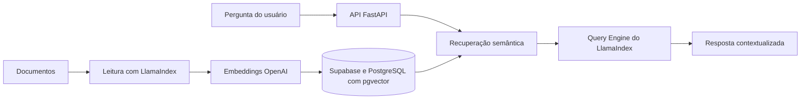

# SmartGPT — RAG e busca semântica

Apresentação pública e sanitizada de uma prova de conceito de back-end para ingestão de documentos, criação de índices vetoriais e geração de respostas contextualizadas por recuperação de informação.

> O código-fonte original permanece em repositório privado. Este repositório apresenta a arquitetura, as capacidades implementadas e os limites do projeto sem expor credenciais, configurações internas ou dados processados.

## Visão geral

O SmartGPT foi desenvolvido para experimentar uma arquitetura de **Retrieval-Augmented Generation — RAG**, conectando documentos, embeddings, armazenamento vetorial e modelos de linguagem por meio de uma API.

A aplicação recebe documentos de um diretório, gera embeddings, armazena os índices em PostgreSQL por meio do Supabase Vector Store e permite consultar o conteúdo utilizando o mecanismo de recuperação e resposta do LlamaIndex.

O projeto foi desenvolvido em setembro de 2023 por Antonio Luiz Migliato como prova de conceito técnica.

## Problema explorado

Modelos de linguagem não conhecem automaticamente o conteúdo privado ou específico de uma organização. O projeto explora como disponibilizar esse conhecimento por meio de uma camada de recuperação que:

1. lê e prepara documentos;
2. converte seu conteúdo em representações vetoriais;
3. armazena os vetores em banco de dados;
4. recupera informações semanticamente relacionadas à pergunta;
5. utiliza o contexto recuperado para produzir a resposta.

## Capacidades implementadas

- API desenvolvida com FastAPI
- Endpoint para criação de índices a partir de documentos
- Leitura de arquivos em diretório com LlamaIndex
- Geração de embeddings com modelo da OpenAI
- Armazenamento vetorial em PostgreSQL
- Integração com Supabase Vector Store
- Recuperação de índices existentes
- Busca semântica sobre o conteúdo indexado
- Geração de respostas contextualizadas
- Separação entre endpoints, schemas, configurações, banco de dados e integrações
- Movimentação dos arquivos processados para diretório separado
- Configuração por variáveis de ambiente

## Arquitetura

## Fluxo de indexação

1. A API recebe o caminho do diretório de documentos.
2. O LlamaIndex carrega o conteúdo dos arquivos.
3. O modelo de embeddings converte o conteúdo em vetores.
4. O Supabase Vector Store conecta o índice ao PostgreSQL.
5. O conteúdo vetorial é persistido para consultas posteriores.
6. Os arquivos processados são movidos para um diretório separado.

## Fluxo de consulta

1. A API recebe uma pergunta.
2. A aplicação se conecta ao índice vetorial armazenado.
3. O mecanismo de recuperação encontra os conteúdos semanticamente relacionados.
4. O Query Engine do LlamaIndex combina a pergunta com o contexto recuperado.
5. A resposta contextualizada é devolvida pela API.

## Tecnologias

### Aplicação

- Python
- FastAPI
- Pydantic

### IA e recuperação

- OpenAI
- LlamaIndex
- embeddings
- RAG
- busca semântica

### Dados

- PostgreSQL
- Supabase Vector Store
- pgvector
- SQLAlchemy

## Organização técnica

A prova de conceito foi estruturada em camadas:

- **API:** endpoints de indexação e consulta
- **Schemas:** modelos de resposta
- **Frameworks:** integração com LlamaIndex e Supabase
- **Configuração:** carregamento de variáveis de ambiente
- **Banco de dados:** parâmetros de conexão e configuração do índice
- **Utilitários:** processamento e movimentação de documentos

## Minha contribuição

- Concepção da prova de conceito
- Definição da arquitetura de RAG
- Desenvolvimento da API em Python e FastAPI
- Integração com OpenAI e LlamaIndex
- Configuração do armazenamento vetorial em PostgreSQL
- Implementação dos fluxos de indexação e consulta
- Organização modular do código

## Segurança e privacidade

O repositório público não contém o código-fonte, documentos indexados, credenciais, strings de conexão, chaves de API ou arquivos de configuração do ambiente original.

No projeto privado, os valores de conexão e a chave da OpenAI são carregados por variáveis de ambiente. Para uma implantação produtiva, ainda seriam necessários controles adicionais de autenticação, autorização, validação de entradas, proteção dos documentos, gestão de segredos, observabilidade e retenção de dados.

## Estado e limitações

- O SmartGPT é uma prova de conceito técnica, não uma aplicação produtiva.
- O projeto demonstra a arquitetura básica de indexação, recuperação vetorial e geração de respostas.
- Não há interface front-end, autenticação de usuários ou gestão de permissões.
- Não há suíte automatizada de testes ou demonstração pública hospedada.
- A sintaxe do código foi validada, mas a execução integrada com serviços externos não foi reproduzida no ambiente atual.
- As dependências são de 2023 e exigiriam atualização e nova validação para uso atual.
- A implementação não comprova adoção, operação contínua ou impacto empresarial.

## Objetivo deste repositório

Apresentar de forma clara a experiência prática com RAG, embeddings, bancos vetoriais, integração entre modelos e dados e desenvolvimento de APIs em Python para aplicações de IA generativa.
